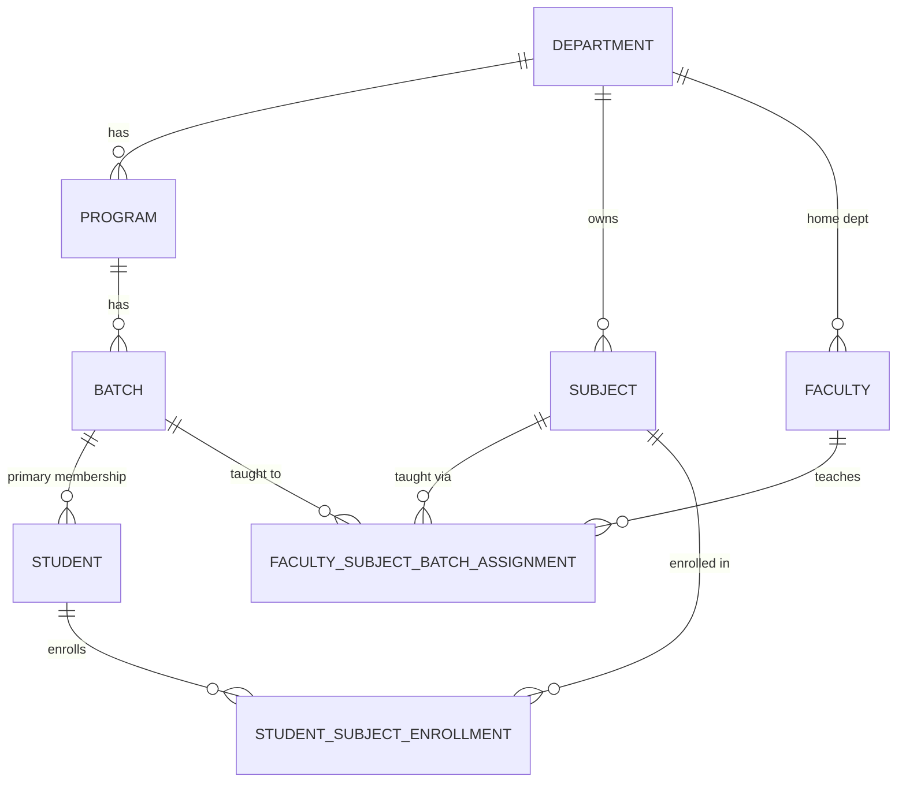
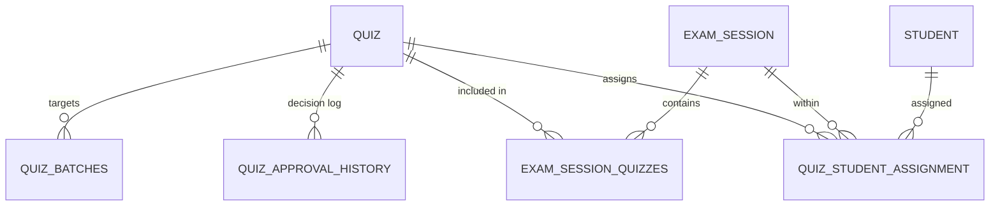
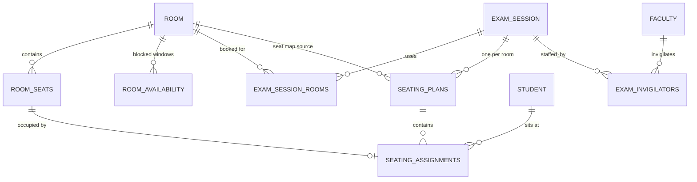
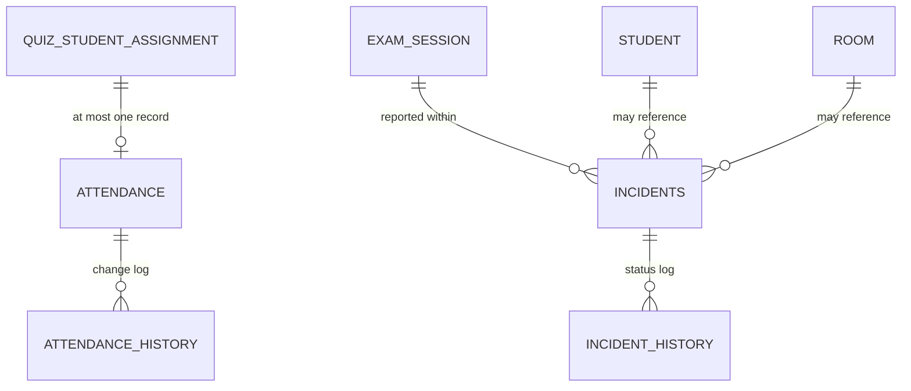

# Exam-Sync — Domain Model (DOMAIN_MODEL.md)

Companion to [ARCHITECTURE.md](ARCHITECTURE.md) §D–§N (full schema) and [PRD.md](PRD.md) (feature scope). This document is the relationship reference — cardinalities and meaning, not implementation.

---

## 1. Relationship Graph (textual)

```
Department (1) ──< Program (1) ──< Batch (1) ──< Student
Department (1) ──< Subject
Department (1) ──< Faculty                 [home department]

Faculty  (M) ──< faculty_subject_batch_assignment >── (M) Subject
                              │
                              └──< (M) Batch

Student  (M) ──< student_subject_enrollment >── (M) Subject
                              │
                              └── (1) Batch  [batch context at enrollment time]

Faculty (1) ──< Quiz  [created_by]
Quiz (1) ──< quiz_batches >── (M) Batch
Quiz (1) ──< quiz_approval_history

Quiz (M) ──< exam_session_quizzes >── (M) Exam Session
Quiz (1) ──< quiz_student_assignment >── (1) Student, (1) Exam Session

Exam Session (M) ──< exam_session_rooms >── (M) Room
Room (1) ──< room_seats
Exam Session (1) ──< seating_plans (per room) ──< seating_assignments >── (1) Student, (1) Seat, (1) Quiz
Exam Session (M) ──< exam_invigilators >── (M) Faculty [+ Room]

quiz_student_assignment (1) ──── (0..1) attendance ──< attendance_history
Exam Session (1) ──< incidents >── (0..1) Student, (0..1) Room, (0..1) Seat, (0..1) Quiz

* ──< audit_logs
* ──< notifications (recipient: Student or Faculty)
```

## 2. Mermaid ER Diagram — Academic Core



**Why not `Subject → Faculty` or `Subject → Batch` direct FKs**: both relationships are genuinely many-to-many and context-dependent (a subject is taught by different faculty to different batches). A direct FK on `subjects` could only point to one faculty/batch, immediately breaking the "Faculty A teaches DBMS to Batch A and B; Faculty B teaches DBMS to Batch C" requirement. The junction tables (`faculty_subject_batch_assignment`, `student_subject_enrollment`) are the actual source of truth; `subjects` and `batches` stay pure catalog/roster entities with zero teaching/enrollment knowledge embedded.

## 3. Mermaid ER Diagram — Quiz & Exam Session



Cardinality note: `exam_session_quizzes` is the M:N join that makes "one session, many quizzes, many subjects, many faculty" possible — a session has zero implicit subject; every subject present in a session is explicit via its quizzes.

## 4. Mermaid ER Diagram — Rooms, Seating, Invigilation



Cardinality: `seating_assignments` has a `UNIQUE(seating_plan_id, seat_id)` and `UNIQUE(seating_plan_id, student_id)` — this is the formal statement of "one student per seat, one seat per student," enforced at the database, not merely asserted by application logic.

## 5. Mermaid ER Diagram — Attendance & Incidents



`attendance` is 1:0..1 with `quiz_student_assignment` (a student may not yet have attendance marked — lazy creation, see ARCHITECTURE.md §Y). It is **not** 1:1 with `Student` directly, because a student has one attendance record *per quiz they sit*, not one overall.

## 6. Every Relationship, Explained

| Relationship | Cardinality | Meaning | Why not simpler |
|---|---|---|---|
| Department ↔ Program | 1:N | A program belongs to exactly one department | Straightforward hierarchy — no M:N need here |
| Program ↔ Batch | 1:N | A batch is a cohort within one program | — |
| Batch ↔ Student | 1:N | Student's primary/administrative batch | This is NOT the exam-eligibility path — see enrollment |
| Department ↔ Subject | 1:N | A subject is catalogued under one owning department | A subject *taught across* departments (rare, e.g. "Math" taught to CSE) is handled by enrollment/assignment, not by multi-department subject ownership |
| Faculty ↔ Subject ↔ Batch | M:N:N via junction | Real-world teaching assignment | Direct FK impossible without duplicating subject/faculty rows per pairing |
| Student ↔ Subject | M:N via `student_subject_enrollment` | Enrollment, independently statused and dated | Batch membership is not sufficient signal for "is taking this subject" |
| Quiz ↔ Batch | M:N via `quiz_batches` | A quiz may target more than one batch of the same subject | A single quiz instance run across combined batches (a common real scenario) shouldn't require duplicate quiz rows |
| Quiz ↔ Exam Session | M:N via `exam_session_quizzes` | Multiple quizzes combine into one session; a quiz could theoretically be scheduled in only one session (business rule may restrict to 1:N in practice — see BR-014) | Junction table kept generic; uniqueness enforced by business rule, not schema, to allow future rescheduling flexibility |
| Student ↔ Quiz | M:N via `quiz_student_assignment`, but practically 1:1 per quiz | A student is assigned once per quiz (`UNIQUE(quiz_id, student_id)`) but can be assigned to many quizzes | — |
| Exam Session ↔ Room | M:N via `exam_session_rooms` | A session can span multiple rooms; a room hosts one session per time window (exclusion constraint) | — |
| Room ↔ Seat | 1:N | Seats are materialized, individually addressable/disable-able | Computing seats on the fly from rows×columns can't express a disabled/accessible seat |
| Student ↔ Room ↔ Seat | via `seating_assignments`, resolved per (student, seating_plan) | The permanent record of where a student sat for a specific quiz within a specific session | — |
| Exam Session ↔ Invigilator | M:N via `exam_invigilators`, scoped additionally by Room | A faculty invigilates a specific room within a session, not the session abstractly | Room-scoping is what lets "Room 101: Faculty X, Y; Room 102: Faculty Z" be expressed precisely |
| Exam Session ↔ Attendance | Indirect, via `quiz_student_assignment` | Attendance always resolves back to session through the assignment record | Avoids a redundant direct FK that could drift out of sync |
| Exam Session ↔ Incident | 1:N | Incidents are always scoped to a session; optionally further scoped to quiz/student/room/seat | Nullable FKs on incidents because not every incident involves a specific student (e.g., a general room technical issue) |

## 7. Orphan-Concept Check

Every entity introduced anywhere in PRD.md, ARCHITECTURE.md, BUSINESS_RULES.md, and API_CONTRACT.md is reachable from this graph: Department, Program, Batch, Student, Faculty, Subject, Enrollment, Assignment, Quiz, Approval History, Exam Session, Session-Quiz link, Student Assignment, Room, Seat, Room Availability, Session-Room link, Seating Plan, Seating Assignment, Invigilator, Attendance, Attendance History, Incident, Incident History, Notification, Audit Log, User/Role/Permission (RBAC, not shown above — see ARCHITECTURE.md §AC for full RBAC tables). No concept exists in the PRD without a corresponding modeled entity, and no entity here lacks a PRD-level feature that produces or consumes it.
